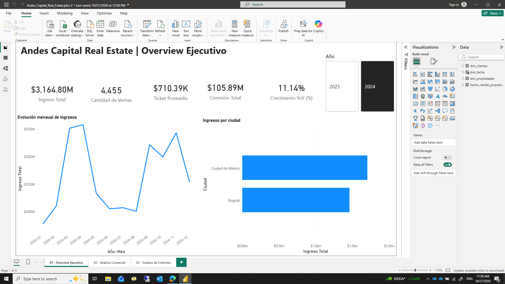
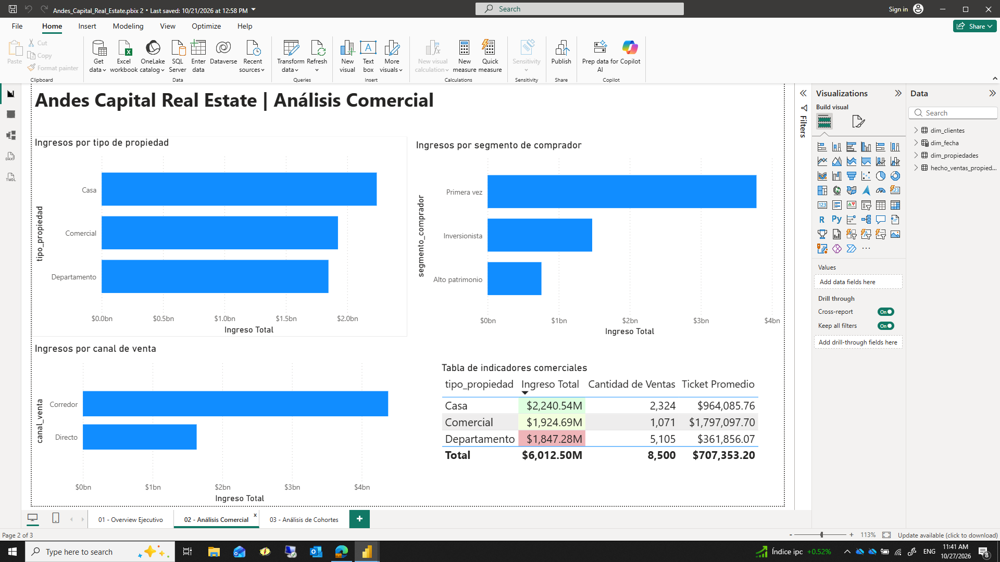
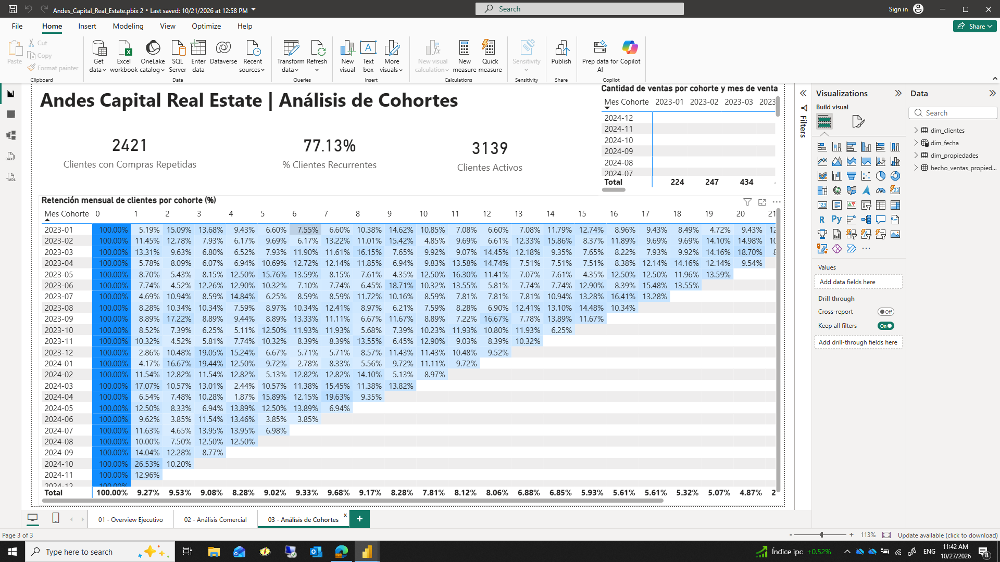

# Andes Capital Real Estate | Power BI Dashboard

## Project Overview

Practical Power BI project focused on real estate sales performance, financial KPIs, buyer segmentation, and customer retention analysis.

## Tools and Skills

- Power BI Desktop
- Interactive data visualization
- Financial and commercial KPI analysis
- Customer segmentation
- Cohort and retention analysis

## Dashboard Pages

### 1. Executive Overview
Revenue, number of sales, average transaction value, commissions, year-over-year growth, monthly trends, and revenue by city.

### 2. Commercial Analysis
Revenue by property type, buyer segment, and sales channel, supported by a detailed KPI table.

### 3. Cohort Analysis
Repeat customers, active customers, customer recurrence, and monthly retention patterns.

## Project Type

Practical Data Analytics portfolio project.

## How to Explore

## Dashboard Preview

### Executive Overview

### Commercial Analysis

### Cohort Analysis

Open the `.pbix` file using Microsoft Power BI Desktop. Dashboard screenshots are included in the repository.
